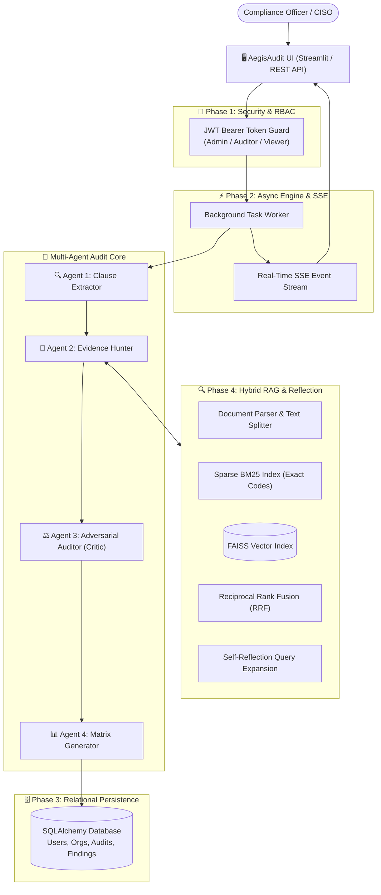

# 🛡️ AegisAudit AI: Autonomous Regulatory & Compliance Audit Platform

An enterprise-grade, Multi-Agent AI system that autonomously audits corporate policies, vendor contracts, and technical architecture documents against strict regulatory standards (such as **ISO 27001, GDPR, HIPAA, SOC 2, or NIST**).

---

## 🚀 Production-Grade Implementation Status

| Phase | Milestone | Features Delivered | Status |
| :---: | :--- | :--- | :---: |
| **Phase 1** | **🔐 Authentication & RBAC** | JWT tokens, bcrypt password hashing, roles (`admin`, `auditor`, `viewer`), route guards, pre-seeded admin account | ✅ **Completed** |
| **Phase 2** | **⚡ Async Job Queue & SSE Streaming** | Background task execution, non-blocking 202 job creation, live Server-Sent Events (`/api/audit/jobs/{id}/stream`) | ✅ **Completed** |
| **Phase 3** | **🗄️ Database Management** | SQLAlchemy 2.0 ORM, multi-tenant schema (`organizations`, `users`, `documents`, `audit_runs`, `audit_findings`), SQLite/PostgreSQL support | ✅ **Completed** |
| **Phase 4** | **🔍 Hybrid Search & AI Reflection** | Sparse BM25 (regulatory code matcher) + Dense vector retrieval with Reciprocal Rank Fusion (RRF), self-reflection query expansion | ✅ **Completed** |

---

## 🎨 Visual Identity & Color System

| Role | Color Name | Hex Code | Purpose |
| :--- | :--- | :--- | :--- |
| **Canvas Background** | Obsidian Slate | `#0B0F19` | Deep, distraction-free modern dark canvas |
| **Card / Surface** | Slate Midnight | `#111827` | Elevated content surfaces & glassmorphism |
| **Primary Accent** | Cyber Sky | `#0EA5E9` | Interactive buttons, active states, highlights |
| **Compliant Status** | Emerald Mint | `#10B981` | Fully verified compliance badge (`#34D399`) |
| **Partial Status** | Radiant Amber | `#F59E0B` | Partial compliance / ambiguous controls (`#FBBF24`) |
| **Non-Compliant** | Crimson Rose | `#EF4444` | High-risk gap / missing control violation (`#F87171`) |
| **Typography** | Inter & JetBrains Mono | `#F9FAFB` | High-contrast readable typography |

---

## 🏛️ System Architecture



---

## 📂 Project Structure

```text
Autonomous-Research-Agent-RAG-Based-/
├── core/
│   ├── config.py              # Environment settings & directory management
│   ├── logger.py              # Structured logging for agent traces
│   ├── security.py            # Password hashing (bcrypt) & JWT token handling (Phase 1)
│   └── job_manager.py         # Async background worker & SSE event broker (Phase 2)
│
├── models/
│   ├── user_schema.py         # Pydantic schemas for Auth & RBAC (Phase 1)
│   ├── job_schema.py          # Pydantic schemas for async jobs & event streams (Phase 2)
│   ├── db_models.py           # SQLAlchemy ORM models: Orgs, Users, Documents, Audits (Phase 3)
│   ├── audit_schema.py        # Pydantic schemas (AuditFinding, FullAuditReport)
│   └── document_schema.py     # DocumentChunk and DocumentMetadata schemas
│
├── rag/
│   ├── document_parser.py     # Multi-page PDF text extraction with page metadata
│   ├── text_splitter.py       # Contextual chunking preserving exact page numbers
│   ├── embeddings.py          # SentenceTransformers & dense fallback vectorizer
│   ├── vector_store.py        # Persistent FAISS / NumPy cosine vector store
│   └── hybrid_search.py       # BM25 + Dense vector Reciprocal Rank Fusion (Phase 4)
│
├── agents/
│   ├── base_agent.py          # Unified LLM connector (Gemini, OpenAI, HuggingFace)
│   ├── clause_extractor.py    # Agent 1: Decomposes frameworks into structured clauses
│   ├── evidence_hunter.py     # Agent 2: Hybrid RAG & self-reflection query expansion
│   ├── compliance_auditor.py  # Agent 3: Adversarial auditor & gap analyzer
│   ├── matrix_generator.py    # Agent 4: Synthesizes executive report & scores
│   └── orchestrator.py        # Workflow coordinator with progress telemetry
│
├── api/
│   ├── server.py              # FastAPI application entry point with CORS
│   ├── deps.py                # JWT auth and RBAC dependency injection (Phase 1)
│   └── routes/
│       ├── auth.py            # /register, /login, /me, /users (Phase 1)
│       ├── audit.py           # /run, /jobs/submit, /jobs/{id}/stream, /history (Phase 2)
│       └── documents.py       # Document upload and listing endpoints
│
├── db/
│   ├── session.py             # SQLAlchemy session factory & connection manager (Phase 3)
│   ├── user_store.py          # User persistence & default admin account seeding (Phase 1)
│   └── storage.py             # Audit run persistence and historical queries
│
├── utils/
│   ├── risk_scorer.py         # Quantitative compliance scoring & risk matrices
│   └── report_exporter.py     # Export to Markdown, CSV, and JSON
│
├── ui/
│   ├── dashboard.py           # Interactive Streamlit dashboard with Auth, RBAC & Filters
│   └── styles.py              # Obsidian Slate & Cyber Cobalt CSS theme
│
├── app.py                     # Streamlit application runner
├── main.py                    # FastAPI backend runner
├── requirements.txt           # Production dependencies
└── .env.example               # Configuration template
```

---

## 🚀 How to Run

### 1. Install Dependencies
```powershell
pip install -r requirements.txt
```

### 2. Launch the Production-Grade Pure React Application
```powershell
python main.py
```
Open your browser and navigate to:
👉 **`http://127.0.0.1:8000/`**

> **Default Seeded Admin Credentials:**
> - Email: `admin@aegisaudit.com`
> - Password: `AdminPass123!`
> *(Click "💡 Auto-Fill" on the sign-in modal for 1-click access)*

* **Executive Dashboard**: SVG Health Posture Donut, real-time KPI metrics, risk breakdown.
* **Audit Studio**: 3-step wizard with pre-seeded standards, multi-document policy corpus selection, and live SSE multi-agent thought stream.
* **Compliance Matrix & Deep Inspector**: Split-screen view with search, filter pills, policy citations, highlighted evidence, gap analysis, engineering fix recommendations, and auditor review governance controls.
* **Standards Catalog**: ISO/IEC 27001:2022, SOC 2 Type II, GDPR Article 32, NIST CSF 2.0 with one-click audit launch.
* **Compliance Diff & Regression**: Compare two audits to measure compliance score delta (+/-%), track resolved gaps, and prevent regressions.
* **Export Center**: One-click downloads for Official Cryptographically Sealed PDF (ReportLab + SHA-256 seal), Jira Tasks CSV, Full Matrix CSV, and Markdown.
* **Interactive Swagger REST Docs**: `http://127.0.0.1:8000/docs`

